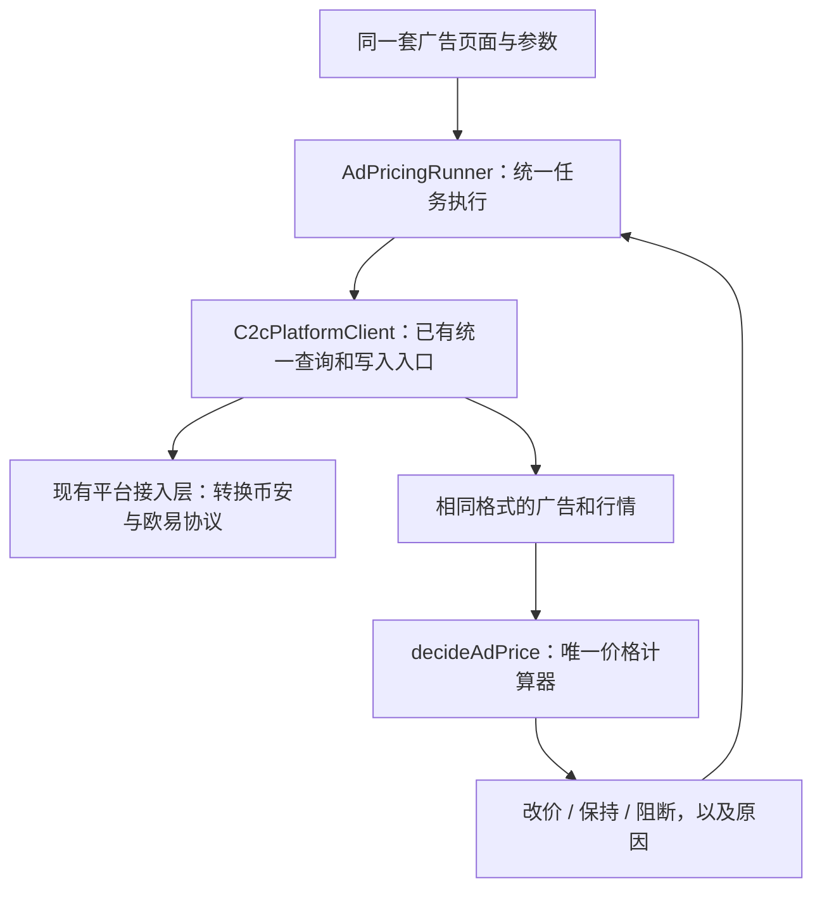

# 买 USDT 广告管理：统一策略与代码抽象方案

日期：2026-10-15。状态：已完成方案审查及代码实现，验证结果见文末；真实平台实盘改价尚未验收。本版按最新要求替换“两个平台分别实现策略”的设计。

**币安与欧易共用一个策略计算器、一套配置和一条执行流程。平台接口差异封装在已有接入层。** 以 P2PTradeBotPro 的普通跟价、动态利润线和加价格子为算法基础，移除欧易不合理分支，修正模板中的明确缺口。以下新增统一规则均单独说明，不冒充源码已有功能。

范围：商家付法币、收 USDT 的买币广告。动态功能原先只在币安模板中存在；现在作为本系统共用能力供两个平台使用，前提是对应接口能提供所需数据。

## 1. 后台仍然只有两个菜单

| 菜单     | 功能                                                                        |
| -------- | --------------------------------------------------------------------------- |
| 广告列表 | 选择商家、同步广告、查看当前价、设置策略、试算、立即执行、开启/暂停自动调价 |
| 调价记录 | 查看查询条件、参考价、价格上限、同行取舍、建议价、提交结果与平台回查结果    |

币安、欧易在同一个列表里，用平台筛选区分。参数设置共用同一套表单，不创建两套页面。不增加“广告能力”检查入口，接口问题由后台在实际操作时返回具体原因。

只保留两个策略模式：**普通跟价、动态跟价**。自动调价是独立启停开关；暂停只停止新的调价任务，不代表平台广告下架。

## 2. 统一策略怎么运行

### 普通跟价

1. 查询自己的当前广告和其他商家收 USDT 的广告。
2. 按金额、支付方式、商家类型、指定同行及黑名单筛选，排除自己。
3. 对同行计算“高一格”的目标价：`(floor(同行价 / step) + 1) × step`。
4. **目标价超过买价上限的候选排除**。在剩余候选中，按目标价、同行原价从高到低选一个；持平按稳定广告标识排序。
5. 与自己当前价相同则不改；不同则提交，再回查平台实际价格。

步长来自币安源码的 `calculate_competitor_target()`：同行 7.09、步长 0.01 → 7.10；同行 7.091 → 7.10。

**统一后，价格线是最终提交价格的上限。** 源码只过滤同行原价，可能算出超限目标；这里明确修正这一缺口。不是把超限价格强行截成上限，而是排除该候选，继续选下一家。

### 动态跟价

先从别人卖 USDT 的广告中取参考价，再计算本轮买价上限：

```text
原始动态上限 = 参考卖价 − 每个 USDT 预留价差 − 参考卖价 × 手续费率 / 100
可提交上限   = 按固定价格单位 0.01 向下取整
```

然后执行同一个同行筛选与选价流程。

利润公式来自币安源码 `calculate_threshold_stablecoin()`。向下按价格单位处理是本系统对“舍入后可能提高上限”的统一修正，替换模板固定 `round(..., 2)`；计算使用 Big.js 十进制运算，金额以字符串传输。按当前业务约定，两平台共用固定价格单位 `0.01`，不再要求填写或提交 `priceTick`。旧 JSON 中的该字段不参与计算，重新保存策略后移除，无需数据库结构迁移。

**普通模式用手填上限，动态模式用计算上限。** 两个模式只改变上限的来源，不复制两套选价算法；也不额外增加“动态线与普通线取最小值”的条件。

### 同一组案例，两个平台结果一样

假设行情已转换成同一组数据：A=7.08、B=7.09、C=7.12，步长 0.01，平台允许 0.01 的价格精度，自己的当前价 7.05。

| 配置                                       | 本轮上限 | 选择过程                               |   建议价 |
| ------------------------------------------ | -------: | -------------------------------------- | -------: |
| 普通，上限 7.10                            |     7.10 | C 的目标 7.13 超限；B 的目标 7.10 合格 | **7.10** |
| 动态，参考 7.20、预留 0.05、手续费 0.11%   |     7.14 | C 的目标 7.13 合格，且最高             | **7.13** |
| 动态，参考 7.20、预留改为 0.08、手续费不变 |     7.11 | C 超限；B 的目标 7.10 合格             | **7.10** |

平台行情不同，结果可以不同；**相同的标准化输入必须得出相同决策，平台名称不参与计算**。

## 3. 统一参数，清理无效字段

| 后台名称           | 统一字段                                        | 来源与含义                                                                 |
| ------------------ | ----------------------------------------------- | -------------------------------------------------------------------------- |
| 策略模式           | `mode`                                          | 普通/动态；承接源码策略开关，使用明确枚举                                  |
| 普通买价上限       | `fixedLimit`                                    | 来自 `threshold`，普通模式必须大于 0；不再用 0 表示无限制                  |
| 价格最小单位       | 服务端固定常量                                 | 固定为 `0.01`，无需配置                                                   |
| 加价格子           | `step`                                          | 来自有效的 `step`；必须是 `0.01` 的正整数倍                               |
| 同行查询金额       | `competitorAmount`                              | 合并普通 `filtr` 与动态 `strategy_filtr`，两种模式共用一个条件             |
| 同行支付方式/时限  | `competitorPaymentMethods` / `competitorPeriod` | 来自实际生效的 `banks` / `period`；多支付方式统一表示“匹配任意一种”        |
| 只看商家           | `merchantOnly`                                  | 来自 `publishertype`，两类行情查询都使用                                   |
| 自动排除自己       | 无需配置                                        | 每轮读取当前商家全部自有广告号，同时排除买币同行和卖币参考中的自有广告     |
| 指定同行/黑名单    | `followNickname` / `blockedNicknames`           | 精确匹配平台公开昵称；不做包含匹配，也不混用昵称和 ID                      |
| 每个 USDT 预留价差 | `profitPerUsdt`                                 | 来自 `profit`，单位是法币/USDT，不是百分比                                 |
| 手续费率（%）      | `feePercent`                                    | 来自 `binance_fee`，去掉平台命名；各商家填实际费率，0.11 表示 0.11%        |
| 参考卖价支付方式   | `referencePaymentMethods`                       | 来自 `position_banks`，与同行支付方式分开                                  |
| 参考卖价位置       | `referencePosition`                             | 来自 `price_position`；本系统从 1 开始，范围 1～10；首期不导入旧机器人配置 |
| 检查间隔           | `intervalSeconds`                               | 来自 `delay`；范围 15～86400 秒；统一调度，不再平台各自写循环              |

动态计算出的上限是本轮结果，只读展示，不作为第二个可手填的策略字段。最高价不代表累计收币预算，查询条件不修改自己广告的限额或支付方式。

自动排除的依据是当轮从平台读取的全部自有广告号，不依赖后台曾同步的买 USDT 广告，也不按昵称猜测。读取自有广告失败或找不到当前广告时，本轮失败且不提交改价；执行证据保存 `ownAdIds`，用于核对排除依据。接口不再要求或使用 `ownNickname`，旧客户端传入的该字段按白名单规则忽略，已有 JSON 策略中的旧值不影响计算，重新保存后移除；无需数据库结构迁移。

不保留 `strategy_step`、`strategy_banks`、`strategy_period`、欧易 `number_one` 这些会产生重复设置、无效设置或提前截断候选的字段。欧易更新接口需要的 `base_amount`、`receipt_id` 等属于广告属性或协议数据，由接入层读取和维护，不进入价格计算器。

副广告联动已按源码触发方式接入：主广告需要改价时，按 `主价 × (1 − 折扣系数)` 计算副价，再按固定 `0.01` 向下取整。主广告回查生效后提交副价，副广告使用独立记录及现有待核实流程；主价无需变动时不额外补发副价。副广告选择同商家、同法币的买 USDT 广告，不另跑自己的跟价策略。

## 4. 行情先统一，再进入计算器

平台请求里的 `BUY/SELL/side` 都由接入层转换。计算器只认识商家视角：**收币同行、卖币参考**，避免买卖方向混乱。

- 收币同行：同币种、同法币，按配置匹配金额、支付方式、商家类型及受支持的时限条件。
- 卖币参考：同平台、同币种、同法币，按参考支付方式和商家类型查询，不沿用同行金额和付款时限条件。
- 数据统一包含：广告标识、商家标识/昵称、方向、价格、交易限额、支付方式和查询时间。缺失必要字段、价格非正数、方向错误或行情过期，本轮阻断，不用默认值凑数据。
- 收币同行统一按报价从高到低、卖币参考统一按报价从低到高排序，价格相同时按广告标识排序。币安取第一页 20 条同行、10 条参考；欧易取第一页最多 100 条。只在本轮实际返回、去重并筛选后的报价范围选价，不能声称全市场最优。记录保留实际页码、窗口大小、查询时间与条件。
- 参考列表排除自己的广告；按位置取值，不足 N 条时沿用源码取最后一条，并在记录中显示实际位置；空列表则阻断。排序、排除自己是统一规范，原币安参考函数没有这两步。
- 多支付方式若需分次查询，合并、去重、统一筛选后只计算一次；不再重复查同一组数据，也不采用循环结果 `min(answers)`。

每个平台仍使用自己的实际市场数据。接口不支持某个配置条件时，明确返回不支持，不能悄悄去掉条件继续计算。

## 5. 代码必须怎样抽象



已实现结构（后端 `apps/admin/modules` 下）：

```text
c2c-ad/
  domain/ad-pricing.engine.ts       # 唯一计算器：上限、筛选、格子、选价
  domain/ad-pricing.types.ts        # 统一规则、行情、决策类型
  ad.service.ts                    # 广告同步、配置、查询和凭据解析
  ad-pricing-runner.service.ts      # 唯一执行流程：调度、串行、提交、回查
  ad-lock.service.ts               # 商家范围串行，同一广告不能重复提交
  ad.controller.ts / ad.dto.ts     # 共用后台接口

c2c-platform/                     # 扩展已有入口和客户端，封装协议差异
```

计算器接口的关键约束是：**入参没有平台类型，没有平台客户端，也不读取凭据或调用网络。**

计算器入口为 `decideAdPrice(input: AdPricingInput): PriceDecision`。入参包含统一规则、自有广告、两类查询条件及行情快照；结果包含 `UPDATE/HOLD/BLOCKED`、目标价、原因和证据。实际类型见 `c2c-ad/domain/ad-pricing.types.ts`，后台 DTO 与失败语义见 [广告 API 文档](../projects/backend/doc/api/main/merchant-ads.md)。

IO 直接使用已有 `C2cPlatformClient` 的 `listAds/getAd/searchAds/updateAdPrice`，不增加只转发的 Gateway。操作范围使用经过鉴权的 `tenantId`、`merchantId`；凭据在接入层解析，不放进计算器、任务参数或记录。

`AdPricingRunner` 通过已有 C2cPlatformClient 查询，调用一次 `decideAdPrice()`，需要改价时通过同一入口提交，再查询广告核实结果。平台选择只发生在现有接入层，前端、任务、计算器都不各写一份。

接入层允许不同 URL、签名、Cookie、字段映射和错误解析；**不允许计算利润线、选择同行、加减步长或决定跟价方式**。OKX 私有协议继续隔离在 `OKX_WEB_PRIVATE` Adapter。

## 6. 明确删除和修正哪些源码行为

| 源码问题                                            | 统一方案                                     |
| --------------------------------------------------- | -------------------------------------------- |
| 欧易买单遇到 `同行价 >= threshold` 就加价           | 删除，统一检查最终目标价不超过上限           |
| 欧易根据与当前价相差两步决定加减，提前返回首个同行  | 删除，统一筛选全部取得的有效候选后选价       |
| 币安加价后可能超过价格线                            | 修正为最终候选价校验，两种模式共用           |
| 动态线为 0 被当成无限制，查询失败或无效价格继续参与 | 无效输入返回 `BLOCKED`，禁止写入             |
| 配置了动态专用步长/银行/时限，但实际没有按配置执行  | 合并为真正生效的统一参数                     |
| 支付方式循环重复请求并取最小结果                    | 合并去重后一次计算，统一选择最优合格候选     |
| 昵称包含匹配、开关字符串、黑名单丢失                | 精确匹配及稳定标识、布尔/枚举、持久化规则    |
| 从广告名称拆币种导致 USDTUSD 解析错误               | 广告币种、法币、方向独立存储，不靠字符串猜测 |
| 发出请求就记录 updated                              | 区分提交、接口受理、回查生效、失败、待核实   |

没找到可提交候选时，当前价未超本轮上限则 `HOLD`；已超上限则 `BLOCKED` 并提示人工处理。不会凭空生成一个降价目标或自动下架，页面须说明旧广告可能仍在线。上限约束新提交价格，不宣称能保证外部广告始终安全。

改价前，在短事务中持久化 PENDING 记录及广告 pendingRunId，再发请求。超时或回查价不符保持待核实；后续轮次只回查，不重复写，不自动丢弃 pending。暂停不取消已有在途请求，仍允许回查。商家范围数据库会话锁让同步、保存、开关、执行串行，锁不跨数据库事务包裹外部请求。提交前再次检查规则版本、商家/所属单位状态和自动开关。欧易修改保留 freshly read 的 online/enterMarket，绝不硬编码 true；响应若返回新 publicId 立即保存并按新 ID 回查。超时且新 ID 未知时保留待核实，不能猜一个广告绑定。权限或凭据失效时返回具体原因，不误报成功。

## 7. 怎么验收“一套代码”

- 计算器只有一个入口，内部没有平台判断，也没有两个平台专用定价类；普通/动态共用候选选择函数。
- 上述三组行情作为共用案例，转换后的输入完全相同时，换平台仍得到 7.10、7.13、7.10。
- 上限 7.10、同行 7.10、步长 0.01 时，该候选目标 7.11 被排除；动态上限无效时阻断，不能解除限制。
- 平台接入测试分别验证买卖方向、金额/支付方式、实际查询窗口和写请求字段的转换；价格单位作为共用规则验证。测试只验证协议，不复制策略用例和算法。
- 预览和自动执行调用同一个计算器；预览不提交平台请求。检查重复任务、旧版本任务及超时回查路径。
- 单一菜单、配置模型、任务和记录模型；所有数据按所属单位和商家隔离，遵守现有迁移、权限、审计及服务端任务注册要求。

代码已按统一 DTO 与验收案例 → 纯计算器 → 现有平台接入 → 统一执行流程 → 两个后台菜单的顺序落地。模板继续只读，不把两个 Python 机器人分别部署成业务后台。

源码依据：币安 `main.py:3540`（利润公式）、`main.py:3632`（加价格子）、`main.py:4045`（候选选价）；欧易 `main.py:694`（现有分支）、`api.py:61`（行情查询）。历史源码行为说明保留在 [买 USDT 广告调价说明](p2ptradebotpro-usdt-buy-ad-pricing.md)，本方案明确授权统一与修正后的行为不等同于模板原行为。

## 8. 实施验收与使用边界

已完成后端、管理后台、菜单权限、正式迁移、系统任务、两平台协议 Mock 与接口文档。审查修正了最终价格超限、OKX 提交前准备失败误留待核实状态，以及换 ID 丢响应后同步可能重复导入广告的问题。未增加平台专用策略、能力检查菜单、自动重试改价或人工强制解除待核实入口。

| 验证                                      | 结果                                                                 |
| ----------------------------------------- | -------------------------------------------------------------------- |
| 后端 lint、类型检查、构建、workspace 检查 | 通过；已生成 migrate 入口、Compose 与 output.zip                     |
| 后端单元测试                              | 112 组 / 732 项通过                                                  |
| 后端数据库集成                            | 32 组 / 107 项通过，其中广告业务 15 项                               |
| 后端接口契约 E2E                          | 8 组 / 78 项通过，其中广告契约 31 项                                 |
| 平台 Mock                                 | 类型检查及 57 项测试通过                                             |
| 前端 lint、类型检查、构建                 | 通过                                                                 |
| 前端单元与核心 E2E                        | 361 项单元通过；桌面及 375px 手机广告流程 10 项通过，E2E 使用模拟 API |
| 仓库检查                                  | diff 格式、Secret 扫描通过                                           |

数据库业务测试通过真实 PostgreSQL、正式迁移、实际平台客户端和本地 HTTP Mock，覆盖两平台试算→改价→回查→重复执行保持，以及真实商家锁、先落库再写入、OKX 换 ID 丢响应后的待核实保护；仅凭据读取使用替身。

协议用例覆盖币安在线 `1`、离线 `3`、关闭 `4`，未定义状态保持未知；业务集成覆盖在线数字状态进入统一动态策略并完成改价和回查。

首次使用：进入广告列表 → 点击“同步广告”，在独立窗口选择经营单位和商家 → 保存策略 → 试算核对参考价、上限及同行取舍 → 立即执行或开启自动调价。同步窗口独立维护选择，不读取或改写列表筛选参数；同步成功后按原筛选刷新列表。调价记录中的“已生效”必须来自平台价格回查，“待核实”不会再次提交。

币安广告状态按仓库内 [币安接口文档](币安接口文档.pdf)（`sapi-v7.4.md`，2024-05-08）第 31 页 `AdDetailResp`、第 36 页 `AdQueryByPageReq` 和第 41 页 `AdUpdateReq` 对齐：整数 `1` → `ONLINE`，`3`（离线）和 `4`（关闭）→ `OFFLINE`；未定义值 → `UNKNOWN`。列表、详情和 Mock 均使用此数字协议；只有在线广告进入调价。状态映射可以按文档和协议测试验收，不需要真实写入才能确认枚举。

尚未执行真实平台实盘写入，因此不宣称已完成真实商家改价验收。OKX 当前只支持固定价格广告，付款时限筛选会明确返回不支持；若写超时且新 ID 丢失，则持续待核实，不能猜绑新广告。两平台价格单位统一固定为 0.01。

首次发布按标准顺序：`migrate` 服务执行已登记的 `C2cMerchantAds1789029000000` → 启动后端 → 发布前端，保持 `synchronize:false`。

2026-10-15 本地开发库验收：最初未迁移实际开发库，导致广告列表和调价记录接口返回 HTTP 500。现已通过正式 `apps/migrate/main.ts` runner 补齐开发库中待执行的 `C2cAutomationScanCorrectness1789027000000`、`C2cTelegramOtc1789028000000` 和 `C2cMerchantAds1789029000000`；`merchant_ad`、`merchant_ad_run` 已建立。实际登录后请求 `/v1/sys/merchant-ads` 和 `/v1/sys/merchant-ad-runs` 均返回 HTTP 200、业务码 200，`/v1/auth/captcha` 返回成功。未启用真实商家自动调价。

## 9. 源码筛选与主副广告补齐

已补齐 `excludeInactive`（超过 1200 秒未活跃排除）、`linkedAdId` / `linkedDiscount`（副广告及折扣系数）。详细契约、失败语义和兼容方式见广告 API 文档末节。币安活跃秒数字段已核对公开行情返回的 `advertiser.activeTimeInSecond`。源码缺失该字段时按 0 处理，因此无数据时不排除。两个平台共用候选筛选及主副联动流程。

新增配置默认关闭、不关联副广告；旧 JSON 策略继续有效，无数据库结构变更，不需要迁移。所有新增平台写入只使用本地 Mock 验证，未操作真实广告。

使用时，在主广告的策略中选择“副广告”，填写“副广告折扣系数”。例如填 `0.01` 表示副价比主价低 1%：主广告本轮改到 `7.10`，副价计算为 `7.029`，按统一价格单位向下取到 `7.02`。先试算查看两条目标价，再执行或开启主广告自动调价；副广告无需单独开启自动调价。主价本轮无需变化时，不额外修改副广告。

业务集成覆盖两平台主副调价、OKX 换 ID、副请求超时及恢复，未进行实盘写入。主副联动本身无新增迁移。

按用户要求删除同行下单限制检查：移除页面开关、策略字段、平台检查调用、Mock 路由和币安新增 Cookie / CSRF 表单。保留不活跃同行筛选和主副广告联动。旧策略里的检查开关失效，保存后移除；无需新增迁移。

## 10. 2026-10-15 广告管理代码审查

审查基线为 `dbeb4e3d8a5a1d41bfb2802022b5a64ac424581d`，范围为本次未提交的广告管理、统一调价、平台协议、Mock、迁移、权限及前端交互。按 `code-review` Skill 分别进行规范与需求审查，验证结果统一记录在第 8 节。

规范审查已修复：

- 广告页面借用商家账号列表权限：改为广告专用商家选项，仅返回当前所属单位的 `id/name/platform`，保留原商家账号权限边界。
- 待核实主广告缺少人工回查入口：显示“核实结果”，复用现有执行接口，只回查、不重发。
- 持有数据库会话锁时另取连接读取商家与凭据：统一使用锁内 EntityManager，增加连接池仅剩一个连接时仍可完成调价的真实数据库回归。
- 删除已排序候选的重复排序，以及保存策略时已检查过的主副关系校验；控制器通过 Service 查询商家选项。

需求审查已修复：

- 币安改价 `data=false` 被当作成功受理：按明确拒绝处理，清除本次在途状态并记录失败。
- 币安行情方向被查询参数覆盖：读取并校验实际 `tradeType`，错误方向阻断。
- Mock 缺少商家类型和付款时限筛选：补齐真实筛选语义及测试，避免假数据掩盖参数未生效问题。

当前未发现未处理的阻断项。验证使用真实 PostgreSQL 和本地平台 HTTP Mock，未进行真实平台改价。此前工作区的 Telegram 统计分页修改不属于本次审查与提交范围。
