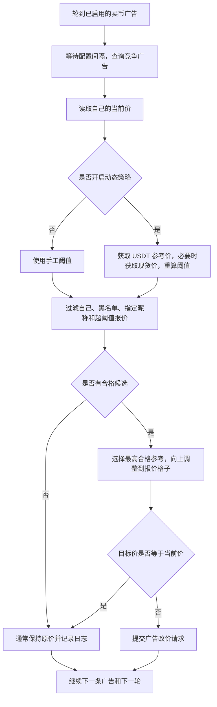

# P2PTradeBotPro 买币广告与调价策略说明

> 分析日期：2026-10-10。
> 来源：`templates/P2PTradeBotPro` 本地源码静态分析，未调用真实交易接口。
> 范围：只说明商家买币广告的筛选、参考价、利润阈值和循环调价。
> 本文是模板研究记录，不代表当前 C2C 产品已经实现这些策略。

## 1. 它替商家做什么

把自己想成一个收币的摊主：别人愿意把币卖给谁，通常会考虑谁出价更高、支付方式是否合适、成交是否方便。

这个机器人替你看同行收币报价，再修改自己已有广告的价格。你设定筛选条件、参考价格和利润要求，它按规则反复计算。

**它自动改价，不会因为看到报价就自动下单买币，也不会自动完成现货兑换或银行付款。**

本文所有 BUY 都从商家角度理解：你付法币，向对方收币。案例中的“元”是统一的假设法币单位，数字不代表实时行情。

| 名称 | 大白话含义 |
| --- | --- |
| 自己的买币广告 | 你公开挂出的收币价签，例如“每个 USDT 出 7.10 元” |
| 竞争同行 | 与你争夺卖币客户的其他收币商家 |
| 参考同行 | 这一轮选来跟价的那条竞争广告，每轮可能变化 |
| 阈值 | 用于筛选竞争报价的价格线；买币时主要排除高于它的同行 |
| 步长 `step` | 报价格子的间隔，例如 0.01 元或 10 元 |
| 动态参考价 | 从 USDT 法币市场指定返回位置取出的价格，用于计算阈值 |
| 利润参数 | 计算愿意出多少钱的依据，不是已经实现的利润 |

## 2. A、B、C 中为什么选择 B

### 2.1 先筛选，再选最有竞争力的报价

例如你收 USDT，配置：

- 法币：案例法币。
- 金额筛选：5,000 元。
- 支付方式：指定银行。
- 同行范围：商家。
- 买币阈值：7.10 元/USDT。
- 步长：0.01 元。

金额筛选是“查询适合这个交易金额的广告”，不是让机器人每次买 5,000 元。付款时限是竞争广告查询条件，不是机器人的付款倒计时。

请求返回竞争广告后，程序排除自己的昵称、黑名单昵称；如果指定了竞争对手昵称，就只保留那个昵称。

| 同行 | 收币报价 | 处理 |
| --- | ---: | --- |
| A | 7.08 | 符合阈值，保留 |
| B | 7.09 | 符合阈值，保留 |
| C | 7.12 | 超过 7.10，排除 |

买币时希望自己的报价比合格同行更有吸引力。因此这一轮选 B，并报 7.10。

```text
合格竞争报价：A = 7.08，B = 7.09
最高合格竞争报价：B = 7.09
自己的目标价：7.09 + 0.01 = 7.10
```

如果客户卖 1,000 USDT，B 付 7,090 元，你付 7,100 元。从价格看，你更有吸引力，但广告排名和最终成交仍受平台及其他条件影响。

**B 被选中是因为报价合适，不是因为字母 B，也不是因为它固定排第二。**

### 2.2 哪些情况会换参考对象

| 变化 | 本轮结果 |
| --- | --- |
| B 降到 7.07，A 仍是 7.08 | 改参考 A，目标价 7.09 |
| B 涨到 7.11，A 仍是 7.08 | B 超阈值，改参考 A，目标价 7.09 |
| A、B、C 都高于 7.10 | 没有合格同行，这一轮通常不改价 |
| 指定竞争对手为 B | 只看 B；B 不在查询结果中时不改价 |
| B 在当前生效黑名单中 | 排除 B，再从其他合格广告中选择 |

稳定币分支实际按“目标价从高到低、同行价从高到低”排序；非稳定币买入分支按同行价从高到低排序。相同步长下，通常就是选择最高合格报价；价格落在相同格子时也可能得到相同目标价。不是根据成交量、信誉分或综合评分选 B。

竞争查询只获取第 1 页、最多 20 条广告。指定昵称没有出现，可能只是没在这 20 条里，不代表它已经下线。

## 3. 普通模式：自己设价格线，机器人跟价

普通模式关闭动态策略，使用手工填写的 `threshold`。

例如你收 USDT，设置阈值 7.10、步长 0.01：

| 轮次 | 最高合格同行报价 | 自己的目标价 | 行为 |
| --- | ---: | ---: | --- |
| 第 1 轮 | 7.08 | 7.09 | 当前价不是 7.09 就提交改价 |
| 第 2 轮 | 7.09 | 7.10 | 加价竞争 |
| 第 3 轮 | 7.07 | 7.08 | 跟着降价，减少不必要的支出 |
| 第 4 轮 | 7.07 | 7.08 | 当前已经是 7.08，就不重复改价 |

所以它不是只会一直涨价，也会在合格竞争报价下降时降低你的收币价。

### 步长不是所有情况下直接相加

代码把步长当作价格格子的间隔：同行报价已经在格子上，就高出一个格子；不在格子上，就向上取到最近格子。

| 同行价 | 步长 | 买币目标价 | 解释 |
| --- | ---: | ---: | --- |
| 7.09 | 0.01 | 7.10 | 已在格子上，加一格 |
| 7.091 | 0.01 | 7.10 | 向上取到下一格，不是 7.101 |
| 426,000 | 10 | 426,010 | 已在格子上，加一格 |
| 426,003 | 10 | 426,010 | 向上取到最近的 10 元格子 |

## 4. 策略模式：用市场和利润要求自动算价格线

策略模式主要改变阈值的来源：普通模式由你手工设线，策略模式用市场报价和利润参数重算线。最终报价仍然主要跟随合格竞争同行。

### 4.1 两组市场数据，作用不同

| 数据 | 用途 | 当前查询行为 |
| --- | --- | --- |
| 目标币种竞争广告 | 决定这一轮具体跟谁、报多少钱 | 自己 BUY 时，搜索请求使用 `tradeType=SELL`，按平台用户视角查询收币同行，最多 20 条 |
| USDT 法币参考广告 | 给利润公式提供法币参考价格 | 固定查询 USDT，自身 BUY 时请求 `tradeType=BUY`，取最多 10 条中的指定位置 |

这两组查询方向不同，是为了分别观察收币竞争市场和另一侧的 USDT 法币报价。不能把源码请求的 BUY/SELL 字段直接当成商家广告方向。

如果你设置 `price_position = 3`，程序取 USDT 参考结果中的第 3 个报价。**它不是承诺把你的买币广告保持在第三名。**

参考查询使用 `position_banks` 支付方式条件，不按目标竞争金额筛选；位置小于 1 时取第 1 个，超过返回数量时取最后一个。参考价格不是实际成交承诺。

### 4.2 买 USDT：按每单位固定利润计算

假设参考查询返回以下价格，你选择第 3 个：

| 返回位置 | USDT 法币报价 |
| --- | ---: |
| 1 | 7.18 |
| 2 | 7.19 |
| 3 | 7.20 |

再设置 `profit = 0.05`，即每个 USDT 预留 0.05 元；`binance_fee = 0.11`，即 0.11%，不是 11%。

```text
动态阈值 = 参考价格 - 固定利润 - 参考价格 × 手续费率
         = 7.20 - 0.05 - 7.20 × 0.0011
         = 7.14208
源码保留两位小数：7.14 元/USDT
```

接下来不是直接把广告设成 7.14，而是用 7.14 筛选收币同行：

| 同行报价 | 是否合格 | 步长 0.01 下的目标价 |
| --- | --- | --- |
| 7.12 | 合格 | 7.13 |
| 7.13 | 合格 | 7.14 |
| 7.16 | 超阈值，排除 | 不参考 |

如果这些广告同时存在，这一轮参考 7.13，报 7.14。如果合格同行最高只报 7.12，就报 7.13，不会仅因为阈值是 7.14 而主动多付。

当参考价跌到 7.15，同样参数下阈值约为 7.09。下一轮会重新筛选同行。不过，如果全部同行都超过新阈值，程序通常保持旧广告价格，不会自动把旧价降到新阈值或下架。

源码对 USDT、USDC 使用这类稳定币分支；USDC 也使用 USDT 市场作为参考，没有另算两者价差。

### 4.3 买 BTC：结合现货价格和目标利润率

经营假设是：收 BTC 后，可能在现货市场换成 USDT，再按法币参考价格折算。机器人只算报价，不替你执行这条交易链。

例如 BTC 现货价为 60,000 USDT，USDT 法币参考价为 7.20 元，目标利润率 `strategy_profit = 1`，即 1%。

```text
法币折算价值 = 60,000 × 7.20 = 432,000 元/BTC
动态阈值 = 432,000 × (1 - 0.0024) ÷ (1 + 0.01)
         ≈ 426,696.24 元/BTC
```

其中 0.24% 是源码固定费用率，与稳定币公式读取的 `binance_fee` 不同。

| 同行收 BTC 报价 | 处理 |
| --- | --- |
| A：425,000 | 合格 |
| B：426,000 | 合格，最高合格报价 |
| C：427,000 | 超阈值，排除 |

步长设为 10 元，这一轮参考 B，目标价是 426,010 元/BTC。现货价或 USDT 法币参考价发生变化，下一轮计算的阈值也会变化。

`profit` 是稳定币每单位固定价差；`strategy_profit` 是非稳定币目标利润百分比。两者不能按同一种单位填写。

## 5. 每轮如何执行，何时不改价



单次 `work` 内可能因支付方式循环查询多次；如果得到多个有效目标价，最终提交其中的最小值。目前循环没有把每个支付方式单独传给查询，不能理解为已经实现了完整的逐银行比价。

配置 `delay = 5` 是循环中的等待及任务等待超时参数。广告数量、接口耗时、重复查询都会影响实际频率，并不是每条广告严格每 5 秒刷新。任务等待超时也不会自动取消已经提交的工作任务。

查询出错、参考价格缺失、没有合格候选时，本轮通常不提交新价格；稳定币分支读取自己价格失败时也不提交。日志记录一次调用不等于平台改价成功，仍需确认接口结果或回查实际价格。

## 6. 买币参数速查

| 参数 | 含义及实际作用 |
| --- | --- |
| `number` | 自己已有广告的编号 |
| `threshold` | 普通模式竞争报价筛选上限 |
| `step` | 实际竞争调价使用的价格步长，两种模式都主要用它 |
| `filtr` / `strategy_filtr` | 普通/策略模式查询竞争广告时的法币金额条件 |
| `banks` | 实际竞争查询使用的支付方式列表 |
| `period` | 实际竞争查询使用的付款时限条件 |
| `publishertype` | `1` 只看商家，其他值不限定为商家 |
| `competitor_nickname` | 只跟随指定昵称；留空时从合格同行中选择 |
| `blocked_ads` | 黑名单昵称，当前版本重启恢复存在问题 |
| `price_position` | 动态参考查询结果中的位置，不是自己广告的目标排名 |
| `position_banks` | 动态 USDT 参考查询的支付方式条件 |
| `profit` | 稳定币每单位预留的固定法币价差 |
| `strategy_profit` | 非稳定币预留的利润百分比，`1` 表示 1% |
| `binance_fee` | 稳定币公式的手续费百分比，非稳定币公式目前固定用 0.24% |
| `strategy_threshold` | 策略模式阈值，会被公式重算并写入配置 |
| `delay` | 调价循环等待参数，不是客户付款时限 |

如果配置副广告，主广告改价后会提交 `副广告价 = 主广告价 × (1 - dubl_discount)`。例如主价 7.10、系数 0.01，副价为 7.029；这里系数 0.01 表示 1%，不会自动继承主报价的格子处理。

## 7. 当前源码不能当成完整的买入保护

以下是已核对的实现限制，不是本文新增的产品需求。

1. **阈值保护同行价，没有严格保护最终价。** 阈值 7.14、同行 7.14、步长 0.01 时，同行通过筛选，最终可能报 7.15。稳定币和非稳定币买入最终分支没有在加价后统一复核上限。
2. **没有合格同行时，旧高价可能继续挂着。** 动态阈值下降，不代表旧广告一定降价。当前没有“重新校验旧价并自动暂停广告”的完整流程。
3. **阈值为 0 的行为因币种不同而不同。** 稳定币分支通常视为不限制；非稳定币普通买入中它被解析为 `False`，随后参与比较，正数报价可能全部被排除。不能统一理解为“0 就随便跟价”。
4. **部分菜单参数未接通。** `strategy_step`、`price_precision`、`competitor_select_mode` 没有完整用于核心竞争调价；实际仍主要使用 `step`。策略模式竞争查询仍用 `banks`、`period`；USDT 参考查询也没有实际使用计算出来的策略付款时限。
5. **黑名单和开关恢复不完整。** 黑名单初始化为空且未自动加载保存值；广告启用和策略切换主要改变内存。初始化还从同一个 `enabled` 字段读取多个不同开关，不能假设重启后准确恢复。
6. **附加检查不能当作有效保障。** 限制检查和活跃度检查的菜单按钮被注释，广告解析未填入所需的广告编号和活跃时间。不能假设已经过滤了不可交易或长期离线同行。
7. **利润是估算，不是承诺。** 参考广告不保证能成交，程序没有完整计算实际购币成本、库存、资金占用、银行费用、滑点和成交盈亏。固定手续费、两位小数舍入和浮点处理也不适合直接作为完整资金计算规范。

如果后续实现严格买入保护，应在报价提交前检查最终价是否超过买入上限，并明确超过时是否跳过、封顶或暂停。没有候选时也要重新检查当前已挂价格，避免“本轮没调价”被误当成“当前价安全”。这些属于改进建议，当前模板没有完整实现。

## 8. 源码核对入口

| 文件与函数 | 对应内容 |
| --- | --- |
| `system/api.py`：`getAdvSearch` | 竞争查询方向、金额、支付方式、付款时限、商家条件和 20 条限制 |
| `system/api.py`：`getAdvSearchPos` | 动态 USDT 参考查询、支付方式和 10 条限制 |
| `main.py`：`getPosPrice` | 参考位置选择及越界回退 |
| `main.py`：`calculate_threshold_stablecoin` | 稳定币固定利润阈值 |
| `main.py`：`calculate_max_buy_price` | 非稳定币现货换算和利润率阈值 |
| `main.py`：`calculate_competitor_target` | 买币加一格或向上取格 |
| `main.py`：`_handler` | 过滤候选、排序选择和最终价格计算 |
| `main.py`：`work`、`main_bot`、`edit_ad` | 多次查询结果汇总、循环执行及主副广告更新 |
| `system/utility.py`：`Tradable` | 参数加载、开关及黑名单初始化 |

源码相对位置为 `templates/P2PTradeBotPro/`。该目录是临时只读参考，不参与产品构建和发布，后续可能删除；本说明保存在根文档目录以保留研究结论。
