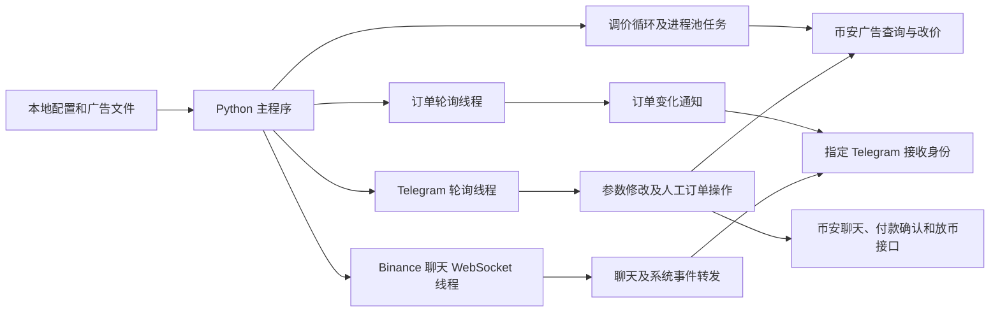

# P2PTradeBotPro 机器人功能总结

> 分析日期：2026-10-11。
> 分析对象：`templates/P2PTradeBotPro` 本地源码，`system/version.txt` 标记为 `1.0.0`。
> 验证方式：静态阅读代码，未启动机器人、未调用真实币安或 Telegram 接口。
> 文档性质：模板功能研究记录，不代表当前 C2C 产品已经实现这些能力。

## 1. 这个机器人能做什么

它是面向币安 P2P 商家的 Python 交易辅助工具：**替你盯同行报价、修改广告价格、通知订单变化，并把订单聊天搬到 Telegram。**

例如，你在币安挂了一条收 USDT 的广告。机器人定期查看同行出价，在设定条件下计算自己的报价；有新订单或订单状态变化时通知你；客户在币安发消息或图片，你可以在 Telegram 查看，再通过按钮给这笔订单回复文字。

买币订单还有“标记已付款”按钮；卖币相关事件还有人工放币入口。这里的“标记已付款”只是在币安更改付款状态，不负责银行转账，也不会核实钱是否真的付出。

它当前围绕一套币安账号凭据、一套 Telegram Bot 配置和一个指定接收身份运行。多个广告可以分别设置参数，但没有多所属单位、多商家账号的权限管理。

## 2. 功能总览

“有主链路”表示源码中存在从入口到调用的逻辑，仍需真实账号权限和接口验证；“部分实现”表示已有方法、配置或按钮，但链路存在缺口。

| 功能类别 | 能力 | 源码实现情况 |
| --- | --- | --- |
| 广告管理 | 下载自己的广告并生成本地配置 | 有主链路，查询第 1 页最多 100 条 |
| 广告管理 | 管理多个币种、法币和交易方向的广告 | 有主链路，逐广告配置 |
| 广告管理 | 单独启停广告的自动调价 | 有 Telegram 菜单，开关恢复不完整 |
| 自动调价 | 普通模式，按手工阈值跟随竞争报价 | 有主链路，买入最终价保护不完整 |
| 自动调价 | 动态策略，用 USDT 参考价、费用和利润计算阈值 | 有主链路，部分策略参数未接通 |
| 自动调价 | 按金额、支付方式、付款时限和商家范围查同行 | 有主链路，策略模式条件使用有不一致 |
| 自动调价 | 指定竞争对手昵称，只跟随该商家 | 有主链路，受首批查询结果范围限制 |
| 自动调价 | 排除自己和黑名单商家 | 有过滤逻辑，黑名单重启加载不完整 |
| 自动调价 | 主广告改价后按折扣联动副广告 | 有主链路，主要依靠文件配置 |
| 订单监控 | 新订单和状态变化通知 | 有主链路，轮询第 1 页最多 100 条 |
| 订单监控 | 展示订单金额、币数量、支付方式和收款人 | 有主链路，不展示完整付款账号字段 |
| Telegram | 查看广告列表、调整策略参数、下载日志 | 有主链路，部分参数仅有编辑代码 |
| 订单操作 | 人工点击“标记已付款” | 有主链路，不执行实际资金付款 |
| 订单操作 | 人工点击放币，使用 TOTP 验证码调用接口 | 部分实现，部分按钮回调名称不匹配 |
| 订单聊天 | Binance 文字消息转发 Telegram | 有主链路，去重和历史补取范围有限 |
| 订单聊天 | 图片转发 Telegram | WebSocket 图片分支有主链路，不能视为凭证核验 |
| 订单聊天 | Telegram 按订单回复文字 | 有主链路，没有图片发送回币安的处理器 |
| 订单聊天 | 等待付款订单发送预设话术 | 有主链路，买卖方向可分别配置 |
| 运行辅助 | 聊天重连、凭据刷新、日志和启动通知 | 有主链路，不等于完整故障恢复 |
| 运行辅助 | 版本检查、模拟订单、重启辅助 | 有代码，但通知条件、模拟隔离和脚本存在缺口 |

## 3. 广告管理与自动调价

### 3.1 获取自己的广告

`download_ads.py` 调用广告列表接口，将广告保存到 `ads/ads.ini`。每条配置包括广告编号、币种与法币、买卖方向、支付方式、价格阈值、步长、利润参数和等待间隔等。

广告配置按“币种 + 法币 + 方向”命名，例如 `USDTUSD_BUY`；同组合出现多个广告时会增加编号后缀。

它主要管理已有广告并修改价格，没有完整的新建广告、修改广告全部字段、发布下架或库存管理流程。Telegram 中的启停主要控制本地自动调价循环，不代表在币安发布或下架广告。

重新执行下载脚本会先删除旧 `ads.ini`，再生成配置，原有手工策略参数可能丢失；不应把它理解为保留参数的无损增量同步。

### 3.2 普通调价模式

你手工设置价格阈值，机器人查询同行广告，过滤自己的昵称、黑名单和不合格报价，再根据步长计算自己的价格。

买币案例：阈值 7.10，步长 0.01；同行 A 出 7.08、B 出 7.09、C 出 7.12。排除 C，在合格候选中参考 B，目标报价为 7.10。同行降价时，自己的广告也可能降低报价。

代码包含 BUY/SELL 分支。稳定币主要按买币向上、卖币向下调整价格格子；非稳定币卖出分支存在逻辑问题，不能认为所有币种和方向均完整可用。

### 3.3 动态利润策略

买币动态策略使用两组数据：

| 查询 | 数据含义 | 用途 |
| --- | --- | --- |
| USDT 法币参考广告 | 币安普通用户“我要买币”列表里，其他商家卖 USDT 的挂价 | 取指定位置的价格，估算市场参考价值并计算阈值 |
| 目标币种收币同行 | 币安普通用户“我要卖币”列表里，其他商家收目标币种的挂价 | 在阈值条件下选择竞争对象，计算具体报价 |

这两组都是当前广告报价，不是成交记录。参考卖价也不是别人承诺按这个价格收你的币。

稳定币买入阈值使用“参考价减固定利润、减手续费”；BTC 等非稳定币买入还结合现货 USDT 价格和利润百分比。`price_position` 是参考列表中取第几个报价，不是自己广告的目标排名。

利润参数只是报价估算，机器人不执行“买币、现货兑换、卖币”的完整套利链，也没有实际利润核算。

买币案例、公式、参数和运行流程详见 [买币广告与调价策略说明](p2ptradebotpro-buy-strategy.md)。

### 3.4 筛选与副广告联动

竞争查询可携带法币、币种、交易金额、支付方式、付款时限和商家类型。程序还可只跟某个昵称，或排除黑名单昵称。当前竞争查询最多返回 20 条，参考查询最多返回 10 条，没有完整翻页。

副广告可以配置 `dubl_number` 和 `dubl_discount`。主广告调价后再计算：

```text
副广告价 = 主广告价 × (1 - 折扣系数)
```

例如主价 7.10、折扣系数 0.01，副价为 7.029。副广告更新没有独立的最终阈值和价格格子复核，也不属于独立的库存或风险策略。

## 4. 订单监控与通知

程序启动后先拉取现有订单，记录状态并初始化聊天历史；这些订单主要作为基线，不逐笔发送“新订单”通知。之后循环查询，新发现的订单或状态发生变化的订单才触发通知。

每轮查询第 1 页最多 100 条，完成处理后等待约 5 秒。因此实际刷新时间还受到请求耗时、详情查询和通知发送耗时影响。

通知内容包括订单号、BUY/SELL 方向、状态、法币总额、币数量和币种。有详情时展示第一种可用支付方式和收款人名称；详情不可用时可能展示对手方昵称。代码虽然读取付款字段，但没有将完整银行账号、卡号等作为通知内容输出。

| 源码状态码 | 通知中的含义 |
| --- | --- |
| 1 | 等待付款 |
| 2 | 已标记付款 |
| 4、5 | 已完成 |
| 6 | 已取消 |
| 7 | 系统取消 |
| 3 等未映射状态 | 显示为未知状态，不应自行解释为申诉状态 |

这里是模板的显示映射，未通过实时接口验证完整的币安状态定义。

订单状态保存在内存中，没有数据库状态历史、可靠同步检查点或完整事件补偿。进程停止期间的所有变化不保证能恢复，第一页之外的订单也不保证被监控。

## 5. Telegram 管理与人工操作

### 5.1 广告与参数菜单

Telegram 提供广告列表、启停标识和参数概览，可进入某条广告设置：普通/策略模式、金额筛选、阈值、步长、支付方式、付款时限、利润、参考位置、指定竞争对手和循环间隔。黑名单支持添加多个昵称、移除单个昵称和清空。

菜单有参数编辑入口不等于计算一定使用了该参数。核心调价仍主要使用 `step`；`strategy_step`、价格精度、竞争对手选择模式、最小/最大金额及价格等设置未完整接入核心逻辑。

一般菜单文本会检查配置的 Telegram 用户 ID，并忽略超过约 7 秒的旧消息；按钮回调和后续交互没有完整、统一的最终鉴权流程。

### 5.2 标记已付款

BUY 订单处于等待付款时，订单通知生成付款确认按钮。点击后获取或补取 `payId`，再调用币安 `markOrderAsPaid`，根据返回结果发送成功或失败提示。

**这一步只做平台付款确认。** 程序没有调用银行、支付宝等资金渠道，没有付款成功证明，也不会核实付款金额和收款账号。付款应由外部流程完成并核实。

### 5.3 人工放币

SELL 相关付款事件可以生成放币按钮。处理器使用本地配置的 TOTP Secret 生成一次性验证码，调用币安 `releaseCoin`。

订单状态通知生成 `binance_release:`，处理器只接收 `release:`，导致这一路按钮无法匹配；聊天付款事件生成的 `release:` 与处理器一致。放币链路不能因此视为全面可用。

程序没有先查银行到账或执行二次确认，不是自动验款放币系统。

## 6. 订单聊天与自动话术

### 6.1 Binance 发来消息

机器人获取 Binance 聊天凭据并建立 WebSocket 连接。收到对方文字时，向 Telegram 转发订单号、发件人和内容；收到带图片地址的图片事件时，转发图片并附订单信息。

付款、完成和延长付款时间等特定聊天系统事件会转换成提示；部分其他事件被忽略。图片可能是付款截图，也可能是其他聊天图片，程序没有 OCR、金额识别或真实性验证。

收到未读数量事件时，还会为已记录的订单查询最近一页聊天历史，尝试补取新文字消息。它不是可靠的全历史同步或统一图片补取流程。

### 6.2 在 Telegram 回复

点击某笔订单的“发送消息”按钮，输入文字后，程序按订单号通过 WebSocket 发回 Binance。可以取消输入；发送失败时保留等待输入状态。

当前接收 Telegram 的处理器只处理文字，没有完整的 Telegram 图片、文件发送到 Binance 的能力。WebSocket 写入成功就被视为发送成功，没有完整的服务端确认、可靠发件队列和失败补偿。

### 6.3 自动话术

订单轮询发现新订单或状态变化后，如果订单处于状态 1，会按 BUY/SELL 方向发送对应配置文本：`notify_seller_text_buy` 或 `notify_seller_text_sell`。

这是按事件发送固定话术，没有 AI 对话、关键词客服、金额模板或多阶段催付规则。启动时已经存在的订单不会仅因初始化而统一重发这段话术。

### 6.4 多语言与连接恢复

订单和主要聊天通知提供英语、乌克兰语、俄语、西班牙语和中文；配置菜单主要为英语，部分回退转发文本仍是其他语言。

聊天连接有每 30 秒心跳、10 秒心跳超时、约 5 秒断线重连和每 6 小时刷新凭据的逻辑。启动时记录历史消息 ID，并在内存中去重，但消息游标没有可靠持久化，不能保证断线或重启期间消息全部补齐。

## 7. 它怎样运行



运行形态是 Python 主进程、后台线程和调价进程池，没有 Web 服务、业务数据库或持久任务队列。主要依赖 `requests`、`pyTelegramBotAPI`、`websocket-client` 和 `pyotp`。

| 文件 | 用途 |
| --- | --- |
| `config.ini` | 币安认证参数、法币、昵称、手续费、话术、语言和 Telegram 配置 |
| `ads/ads.ini` | 下载后生成的逐广告策略参数 |
| `system/headers.json` | 可选的网页认证请求头；存在时广告更新走网页私有接口 |
| `system/settings.json` | 部分辅助方法写入账号信息，不是完整业务配置数据库 |
| `log.log` | 本地运行日志，可通过 Telegram 下载；启动会重写日志文件 |
| `bot.pid` | 当前进程 ID，正常退出时尝试删除，不是完整的单实例锁 |
| `system/version.txt` | 本地版本标记 |

通常流程为：准备 Python 环境和配置，运行广告下载脚本，启动主程序，然后在 Telegram 选择广告并启用调价。本文没有执行这些操作；真实运行还需要币安账号权限、接口可用性和正确的 Telegram 配置。

附带 Windows 安装、启动和下载批处理脚本，但路径硬编码为 `C:\P2PTradeBotPro`；重启脚本仍指向 `C:\P2PTradeBotFirst`，且有宽泛终止进程和 Chrome 的命令，不是可直接沿用的运行管理方案。程序中有 `restart_bot()` 方法，但未见完整 Telegram 重启入口。

版本检查会访问作者版本信息地址并打印更新提示，不自动下载升级。Telegram 更新提示的条件写反，正常配置 Bot Token 时通常不会发送该提示。

## 8. 已发现的实现限制

| 限制 | 对功能的影响 |
| --- | --- |
| 只筛选同行价，未统一复核加步长后的最终买价 | 目标价可能超过阈值 |
| 动态阈值下降但没有合格候选 | 旧高价可能继续挂着，没有自动暂停保证 |
| 策略支付方式和付款时限未完整用于对应查询 | 菜单设置与实际参考范围可能不同 |
| 黑名单初始化为空，开关恢复不完整 | 重启后不能假设保留原来的过滤和启停效果 |
| 限制检查和活跃度检查按钮被注释，广告字段未填齐 | 无法当作有效的候选交易能力保障 |
| 部分放币按钮与回调不匹配 | 从订单状态通知点击放币可能不执行 |
| 缺少统一的回调最终鉴权、资金确认及审计 | 不适合直接作为多操作员资金系统 |
| API Secret、Bot Token 和 TOTP Secret 使用本地明文配置 | 没有完整的密钥加密、版本管理和脱敏体系 |
| 订单和聊天状态主要在内存，查询范围有限 | 重启、漏页和消息积压可能导致漏处理 |
| 部分翻译键缺失 | 如 `seller_bank`、`recipient`、`mark_as_paid` 可能直接显示键名 |
| Telegram 配置为空时仍启动订单及聊天线程 | 不能假设关闭 Telegram 后有完整独立运行能力 |
| 有模拟订单读取，但聊天测试隔离未完整启用 | 不构成安全完整的沙箱模式，不能保证没有真实外部请求 |

这些结论来自当前源码，不代表真实接口已经验证成功，也没有在本次分析中修复模板代码。

## 9. 没有实现的完整业务能力

没有发现以下完整流程：

- 多所属单位、多商家账号、角色权限及资源隔离。
- 自动下单、完整广告发布下架、账户余额及库存管理。
- 银行或支付宝付款、批次付款、退款、到账核验和资金对账。
- 自动申诉、订单取消和完整异常资金恢复。
- 资金账本、实际利润统计、可靠订单状态历史和操作审计。
- Telegram 群级商家绑定、成员权限、多机器人管理和可靠消息收件机制。
- Web 管理后台、分布式调度、持久化任务补偿和高可用运行管理。
- 欧易等其他交易平台的适配。

它适合参考的内容是广告筛选、参考价与竞争价的分工、调价参数、订单通知和 Telegram 聊天交互。把这些能力迁入当前 C2C 系统时，需要重新实现账号边界、权限、可靠任务、最终价格保护和资金审计，不能直接视为已具备的平台能力。

## 10. 源码与验证入口

| 源码位置 | 功能 |
| --- | --- |
| `download_ads.py`；`system/api.py` 的 `load_ad`、`save_ads_to_ini` | 广告下载和本地配置生成 |
| `system/api.py` 的 `getAdvSearch`、`getAdvSearchPos`、`edit_ad` | 竞争查询、参考查询和平台改价 |
| `main.py` 的 `_handler`、`work`、`main_bot`、`edit_ad` | 定价计算、循环执行和副广告联动 |
| `main.py` 的 `OrderStatus`、`ordrs_check_start` | 订单轮询、状态对比、通知和话术触发 |
| `system/api.py` 的 `getUserOrderDetail`、`mark_order_as_paid`、`ReleaseCrypto` | 订单详情、付款确认和放币调用 |
| `main.py` 的 `tg_controller`、`TelegramBot` | 菜单交互、文本和按钮处理 |
| `main.py` 的 `retrieve_chat_messages`、`on_message`、`send_message`、`connect_to_websocket` | 聊天读取、转发、发送和连接恢复 |
| `system/config.py`；`system/utility.py` 的 `Tradable`、`Logger` | 配置加载、逐广告参数和日志 |
| `main.py` 的 `bot_version`；附带批处理文件 | 版本检查和本地运行辅助 |

源码均相对 `templates/P2PTradeBotPro/`。模板目录是只读临时参考，受根 `.gitignore` 排除；功能研究文档存放在根 `docs`，便于模板删除后保留结论。

本次只新增根级功能文档，保留已有买币策略文档；没有修改后端、管理后台、接口契约、数据库或运行脚本。验证包括源码对应关系和 Markdown 文档格式检查，未运行产品构建或真实交易测试，因为没有业务代码改动。无需数据库迁移或发布。
